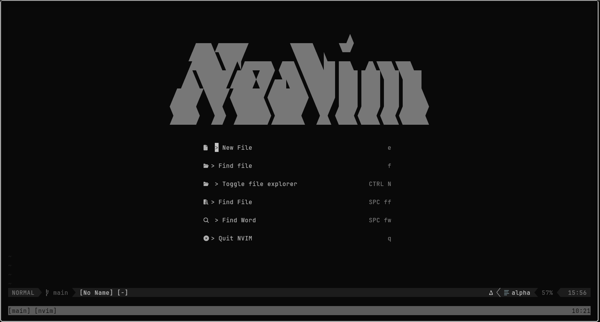
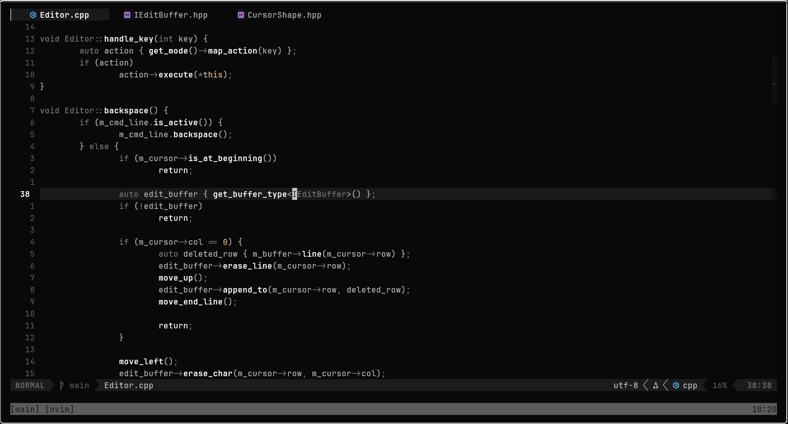
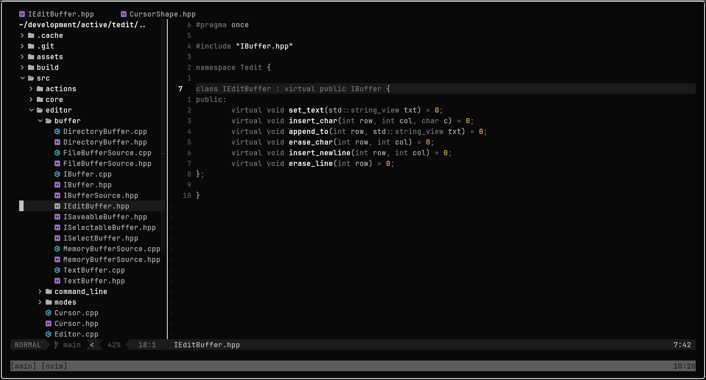
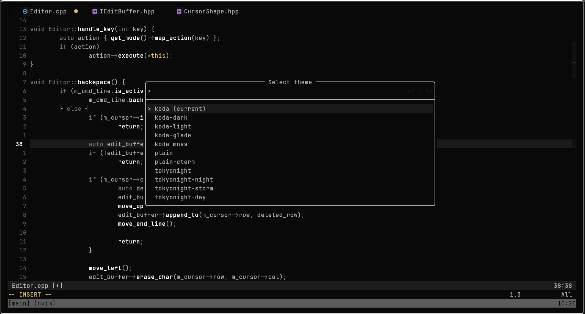

# Pride's Neovim Config

A focused Neovim setup for day-to-day coding, with fast navigation, LSP-backed editing, debugging, file browsing, and a theme workflow that is easy to switch without touching config files.

## Showcase

| Start screen | Code editing |
| --- | --- |
|  |  |

| File tree | Theme picker |
| --- | --- |
|  |  |

## Highlights

- Plugin management through [lazy.nvim](https://github.com/folke/lazy.nvim), bootstrapped automatically on first launch.
- Fuzzy finding, live grep, references, implementations, and diagnostics through Telescope.
- LSP setup for Vue/Nuxt, TypeScript, Java, C/C++, C#/Razor, Lua, Typst, Haskell, shaders, GDScript, Odin, Zig, and more.
- Completion with `nvim-cmp`, LuaSnip snippets, path suggestions, buffer words, and LSP sources.
- Treesitter highlighting for web, systems, scripting, markdown, Haskell, C#/Razor, Rust, PHP/Blade and Godot filetypes.
- Debugging through `nvim-dap`: C/C++/Rust via CodeLLDB and C# via netcoredbg.
- Format on save through `conform`, with the project-local formatter preferred over the global one.
- Git and GitHub: inline blame (GitLens-style), hunk staging, lazygit, diffview, and pull
  requests/issues through `octo`. See [`doc/git.md`](doc/git.md).

### Language stacks

Four stacks are set up end to end, each with its own document:

| Stack | Highlights | Docs |
| --- | --- | --- |
| C# / ASP.NET Core MVC | Roslyn LSP (C# **and** Razor), `:Dotnet*` / `:Ef*` / `:Mvc*` commands, CRUD scaffolding, controller↔view jumps, CSharpier, netcoredbg, C# `:Skel` templates | [`doc/csharp.md`](doc/csharp.md) · how-to: [`doc/CsToolUse.md`](doc/CsToolUse.md) |
| Vue 3 / Nuxt 4 + React / TypeScript | `vue_ls` + Vue-aware `ts_ls`, Tailwind, ESLint, Emmet, prettier, Treesitter | [`doc/frontend.md`](doc/frontend.md) |
| Rust | rustfmt on save, `crates.nvim`, CodeLLDB debugging, manual Cargo checks | [`doc/rust.md`](doc/rust.md) |
| PHP (Laravel **and** vanilla) | intelephense with framework stubs, Blade, `:Artisan*`, `:Php*`, Pint | [`doc/php.md`](doc/php.md) |
- A custom theme picker with persisted selection and quick next/previous theme commands.
- Practical UI touches: file tree, bufferline, lualine, diagnostics, folds, markdown rendering, and quality-of-life editing plugins.

## Install

Back up your existing config first, then clone this repo into Neovim's config directory:

```sh
git clone git@github.com:jhayonline/mac-nvim.git ~/.config/nvim
nvim
```

On first launch, `lazy.nvim` installs itself and then installs the configured plugins.

### External tools

This config targets Apple Silicon. Install Homebrew in its standard
`/opt/homebrew` prefix, then make sure the tools needed by the stacks you use
are available:

- `git`, `make`, and a C compiler for native plugin builds.
- Language servers such as `clangd`, `lua-language-server`, `tinymist`, and `haskell-language-server-wrapper`.
- `lldb-dap` or `codelldb` for debugging C, C++, and Rust.
- `gdshader-lsp` for Godot shader support.
- For C#: the native arm64 .NET SDK (which includes the ASP.NET Core runtime
  and targeting packs), the `roslyn-language-server`, `csharpier`, `dotnet-ef`
  and `dotnet-aspnet-codegenerator` global tools, and `netcoredbg`.
  See [`doc/csharp.md`](doc/csharp.md#installing-from-scratch) for the exact commands.
- `node`/`npm` and project-local `typescript`, `vue-tsc`, ESLint and Prettier for the Vue/Nuxt and React/TypeScript stack. Mason installs the editor language servers.
- `rustup` (cargo, clippy, rustfmt) and `codelldb` for Rust.
- A native arm64 JDK (Java 21 by default), plus Mason's `jdtls`,
  `java-debug-adapter`, and `java-test` packages for Java.
- `glslangValidator`, `clang-format`, and `gersemi` for shader/CMake checks and formatting.
- PHP 8.4, Composer and the Laravel installer for PHP work.
- `git`, `gh`, `lazygit`, `delta`, `rg` and `fd` for version control and search.

Nothing here assumes those tools are already installed on the new Mac. Lazy
and Mason handle editor plugins and language servers; each stack document
separates those from Homebrew, official SDK, and project-local dependencies.

### First launch on the M5

1. Install Xcode Command Line Tools, Homebrew, and a native arm64 Neovim.
2. Install the stack runtimes you need. For Java 21, `brew install openjdk@21`
   is one path the config discovers automatically; .NET and PHP are covered in
   their linked stack guides.
3. Start Neovim, run `:Lazy sync`, open `:Mason`, and run `:checkhealth`.
4. Java debugging/tests and native debugging use Mason packages that are not
   language servers, so install them explicitly when needed:

   ```vim
   :MasonInstall java-debug-adapter java-test codelldb netcoredbg
   ```

5. Open representative `.vue`, `.java`, `.cs`, `.cshtml`, `.php`, `.glsl`,
   and `.wgsl` files. Check `:LspInfo`, `:FormatInfo`, `:DotnetInfo`, Java test
   actions, and `:ShaderCheck` before copying projects onto the machine.

## Keybindings

Leader is `<Space>`.

| Key | Action |
| --- | --- |
| `<leader>ff` | Find files |
| `<leader>fw` | Live grep |
| `<leader>fc` | Search word under cursor |
| `<leader>fW` / `<leader>fF` | Grep / find **including** ignored dirs (`vendor`, `node_modules`, …) |
| `<leader>fb`, `<leader>fh`, `<leader>fk` | Buffers, help, keymaps |
| `<leader>fs` / `<leader>fS` | Document / workspace symbols |
| `<leader>fd` | Workspace diagnostics |
| `<leader>fr` | Resume last picker |
| `<C-n>` | Focus file tree |
| `<leader>e` | Toggle file tree |
| `<Tab>` / `<S-Tab>` | Next / previous buffer |
| `<leader>x` | Close current buffer |
| `<leader>ts` | Select theme |
| `<leader>tn` / `<leader>tp` | Next / previous theme |
| `gd`, `gD`, `gi`, `gt` | LSP navigation |
| `<leader>ca` | Code action |
| `<leader>rn` | Rename symbol |
| `<leader>d` / `<leader>D` | Line / buffer diagnostics |
| `<leader>dc` | Continue debugger |
| `<leader>db` | Toggle breakpoint |
| `<leader>ds`, `<leader>di`, `<leader>do` | Step over / into / out |
| `<leader>gb` / `<leader>gL` | Blame this line / blame the whole file |
| `<leader>gg` | Lazygit |
| `<leader>gs` / `<leader>gr` | Stage / reset hunk (works on a visual selection) |
| `]h` / `[h` | Next / previous hunk |
| `<leader>gm` | Diffview: this branch vs main |
| `<leader>gx` | Open the current line on GitHub |
| `<leader>gop` / `<leader>goi` | GitHub pull requests / issues |

## Commands

| Command | Action |
| --- | --- |
| `:Skel [template]` | Replace the buffer with a skeleton for its file type (C/C++, C#, Java and HTML) |
| `:DotnetBuild`, `:DotnetRun`, `:DotnetWatch`, `:DotnetTest` | .NET build and run, results in the quickfix list |
| `:DotnetTestHere` | Run only the C# test under the cursor |
| `:MvcCrud`, `:MvcScaffold` | Scaffold an ASP.NET Core MVC CRUD controller and its views from an EF model |
| `:MvcAlternate` | Jump between a controller action and its Razor view |
| `:DotnetSecrets`, `:DotnetDevCerts` | ASP.NET user secrets and the HTTPS development certificate |
| `:EfAdd`, `:EfUpdate`, `:EfList`, … | EF Core migrations |
| `:Artisan*` | Laravel artisan, with real `<Tab>` completion from the app |
| `:PhpRun`, `:PhpLint`, `:PhpServe`, `:PhpTest`, `:PhpRepl` | Vanilla PHP — no Laravel needed |
| `:Composer`, `:Pint` | Composer commands and Laravel Pint |
| `:Format`, `:FormatToggle`, `:FormatInfo` | Format now, toggle format-on-save, show active formatters |
| `:DotnetInfo`, `:LaravelInfo` | Show the resolved project context for the current buffer |
| `:TypstPreview` | Open the compiled PDF for the current Typst file |
| `:Theme`, `:ThemeNext`, `:ThemePrev` | Theme picker |

Each stack's full command set is in its document, linked above.

## Structure

```text
init.lua                 Entry point
lua/engine/core/          Options, keymaps, theme state, filetype setup
lua/engine/plugins/       Plugin specs
lua/engine/plugins/lsp/   LSP and Mason setup
lua/engine/tools/         Small local helper tools
after/lsp/               Language server settings that must win the runtimepath merge
ftplugin/                Per-filetype buffer options
doc/                     Long-form documentation
showcase/                README screenshots
```
